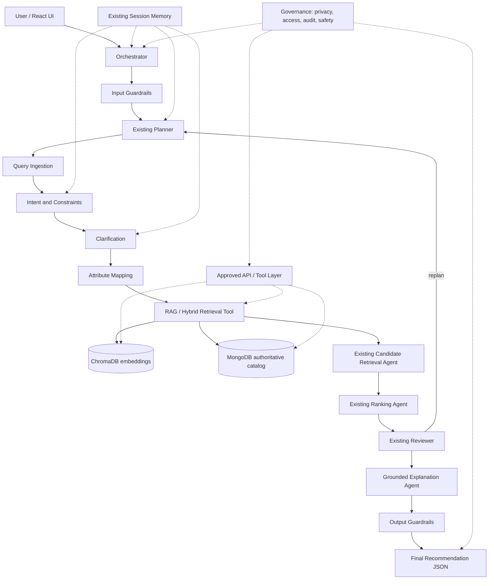

# ShopMuse PS-12 — Hybrid RAG Architecture

## Data and RAG
MongoDB is the source of truth for ID, price, stock, tags and category. ChromaDB stores product descriptions embedded using a local sentence-transformer. Hybrid retrieval first filters MongoDB by hard constraints, then orders eligible records using ChromaDB similarity; it never uses ChromaDB metadata as the price/stock authority. Retrieved text is passed as context to the explanation stage, which uses only verified product fields for its claims. If ChromaDB fails or has not been seeded, structured retrieval still works.

## Existing agents
No new agent class was added. Existing ingestion, intent, clarification, mapping, retrieval, ranking, explanation, fallback, session memory, orchestrator, planner and reviewer are retained. Tool gateway, vector index, guardrails, and governance are infrastructure modules, not duplicate agents.

## Local setup
1. Start MongoDB locally or set a MongoDB Atlas URI.
2. In backend: `python -m venv .venv`, activate environment, `pip install -r requirements.txt`.
3. Copy `.env.example` to `.env`, set `MONGODB_URI` and `GROQ_API_KEY`.
4. Run `python -m app.scripts.seed_catalog` once (and after catalog changes).
5. Run `uvicorn app.main:app --reload`. Frontend remains unchanged: `npm install`, `npm run dev`.
6. Demo-only mode: `CATALOG_BACKEND=json` uses existing JSON if MongoDB unavailable. Vector search still requires ChromaDB and an indexed catalog.

## Tool API
GET `/api/products`, `/api/products/{id}`, `/api/products/{id}/availability`, `/api/semantic-search?q=...`, `/api/hybrid-search?q=...`. Set `SHOPMUSE_API_KEY` for token protection (header `x-api-key`). Do not expose this secret in frontend builds.

## Security and limitations
Input length and common injection patterns are checked; generated claims are deterministic and verified against MongoDB. Raw queries are not logged; audit events use pseudonymous session hashes. In-memory session memory is process-local and not persisted. Public `/chat` is not authenticated: deploy behind an authentication layer and rate limiting before production. Tool endpoints require an API key only when configured. Current controls are baseline guardrails, not a comprehensive security certification.
